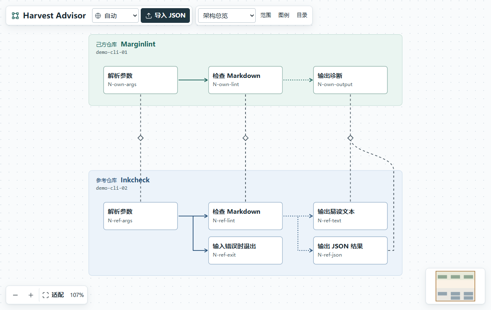
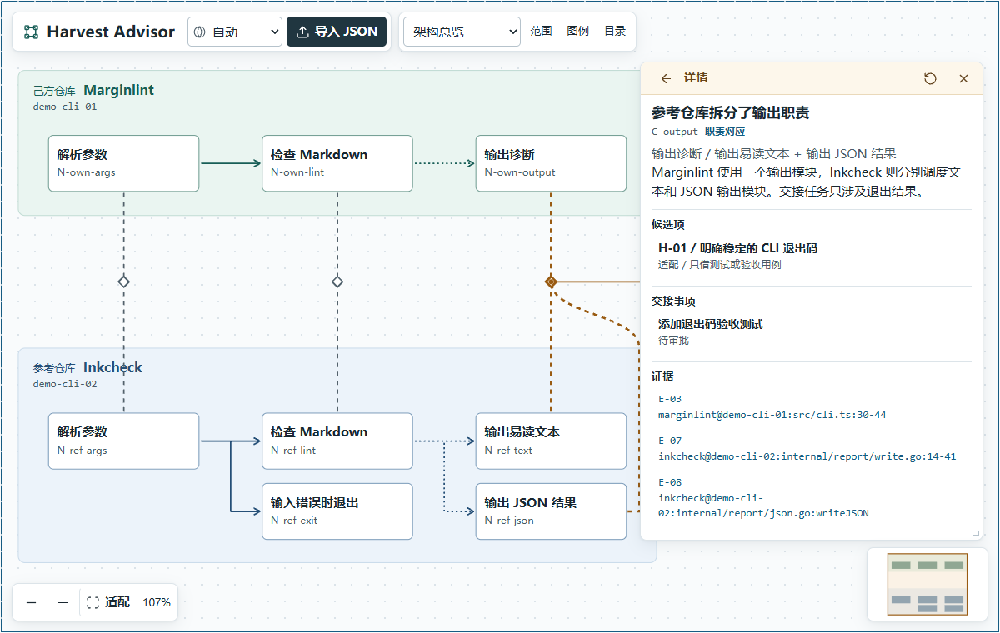

# Harvest Advisor Skill

**English** | [简体中文](README.zh-CN.md)

Compare your repository with one external reference repository, matching what the two projects do rather than how their directories are organized. The skill turns architecture and implementation differences into recommendations backed by source evidence: `adopt`, `adapt`, `reject`, or `watch`. It produces reports for human review and tasks that require approval. It does not migrate or implement changes. See [SKILL.md](SKILL.md) and the [Agent Skills specification](https://agentskills.io/specification).

## Example Run

These screenshots show the actual local viewer in Simplified Chinese, using the public [synthetic Markdown CLI report](viewer/examples/markdown-cli.zh-Hans.json). They contain no real repository data. You can also load the [English version of the same example](viewer/examples/markdown-cli.json).





## Read and Write Boundaries

- The skill only performs static review of the two repositories within the authorized scope. It does not run their code, tests, builds, scripts, or hooks, install their dependencies, modify code, open issues or pull requests, or transmit private content.
- By default, it writes `harvest-advisor-reports/<unique-run>/report.json` only in the authorized local workspace. It never overwrites or deletes earlier reports or writes to the external reference repository. You can request delivery in chat only, offline operation, or no preview.
- In new reports, each `adopt` or `adapt` recommendation needs at least one `approval` task. Each `watch` recommendation needs a `recheck` action and a condition for revisiting it. `save` rejects incomplete new reports, while the viewer and `open` still accept older v1-compatible reports.

## Project-Level Installation and Use

Take the complete `harvest-advisor-skill/` directory from a reviewed Git snapshot and place it in the appropriate location under your project root. Keep the directory name and its contents intact, including `SKILL.md`, `package.json`, `references/`, `scripts/`, and `viewer/`. Copying `SKILL.md` alone is not enough.

| Host | Path relative to the project root |
| --- | --- |
| [Codex](https://developers.openai.com/codex/skills) | `.agents/skills/harvest-advisor-skill/` |
| [Claude Code](https://code.claude.com/docs/en/skills) | `.claude/skills/harvest-advisor-skill/` |
| [Cursor](https://cursor.com/docs/skills) | `.cursor/skills/harvest-advisor-skill/` |

The paths above come from the hosts' official documentation. End-to-end use has not been verified on all three hosts individually. Start a session in the target project and select the skill or name it in your prompt:

> Use harvest-advisor-skill to compare error recovery in the current repository and `<reference repository URL>` without modifying either. Match equivalent behaviors, cite evidence from both repositories, and list any tasks that need approval.

## Offline Quick Start and Local Preview

Open [viewer/index.html](viewer/index.html) directly in a browser, click **Import JSON**, and choose a synthetic report:

- [Markdown CLI (English)](viewer/examples/markdown-cli.json)
- [Markdown CLI (Simplified Chinese)](viewer/examples/markdown-cli.zh-Hans.json)
- [Reservation system comparison (English)](viewer/examples/reservations.json)

The offline viewer does not require Node.js. Saving reports and starting the local preview require Node.js 20 or later and no additional dependencies. For everyday use, choose a [maintained Node.js LTS release](https://nodejs.org/en/about/previous-releases).

The preview binds only to `127.0.0.1` and serves only the selected report and viewer assets. Its URL is for use on the same machine only. Where a native sidebar is available, the skill can open the preview there. Otherwise, it returns the local URL and report path. If local preview is unavailable, open the viewer and import the report manually. If the report cannot be saved safely, the skill delivers it in chat. See [Local delivery](references/local-delivery.md) and the [v1 report contract](viewer/CONTRACT.md).

## Local Tests and Distribution

From the skill directory, run:

```sh
node --test scripts/preview.test.cjs viewer/contract.test.cjs viewer/graph-layout.test.cjs
```

**Distribute only a reviewed Git snapshot. Do not archive the entire local directory.** This repository's ignore rules exclude local reports and copies of real reports. The only public examples are the three synthetic reports listed above. You can add `/harvest-advisor-reports/` to your own project's `.gitignore`; the skill does not modify it for you.

Licensed under the [MIT License](LICENSE).
