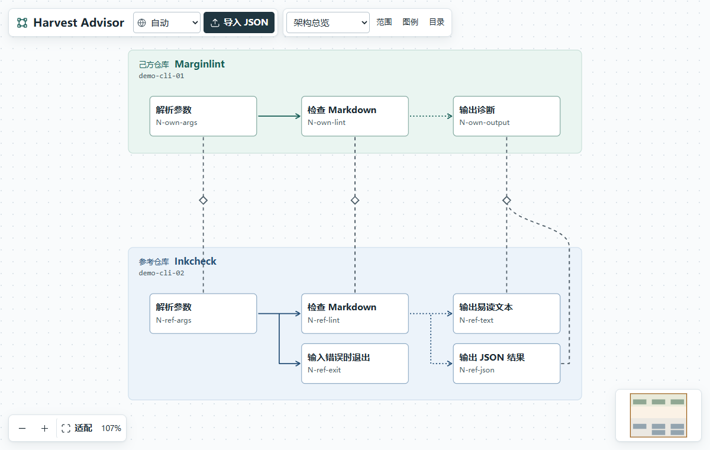
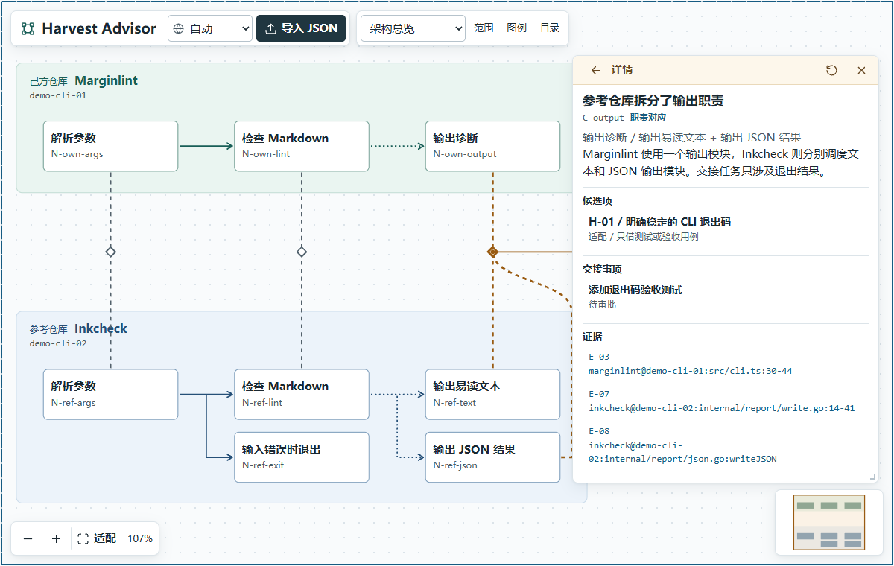

# Harvest Advisor Skill

[English](README.md) | **简体中文**

按业务行为对照己方仓库与一个外部参考仓库，把架构和实现差异整理成带证据锚点的建议：采纳、适配、不采用或观察。输出是供人审阅的报告和待审批任务，不是迁移或实施工具。详情见 [SKILL.md](SKILL.md) 和 [Agent Skills 规格](https://agentskills.io/specification)。

## 运行示例

以下截图来自本机查看器对 [Markdown CLI 合成样例（简体中文）](viewer/examples/markdown-cli.zh-Hans.json) 的实际运行，不包含真实仓库数据。





## 读写边界

- 仅在授权范围内静态阅读两仓，不运行它们的代码、测试、安装、构建、脚本或钩子，不改代码、不创建 Issue 或 PR，不发送私有内容。
- 默认只在授权的本地工作区写入 `harvest-advisor-reports/<unique-run>/report.json`，不覆盖或删除旧报告，不写外部参考仓库。仅对话、只离线或不要预览均可明确指定。
- 新交付的 `adopt` / `adapt` 候选每项要有至少一条 `approval` 待审批任务；`watch` 要有 `recheck` 验证动作与触发条件。`save` 拒绝不完整的新交付，查看器和 `open` 仍能读取兼容 v1 的旧报告。

## 项目级安装与调用

从受审查的 Git 快照获取完整的 `harvest-advisor-skill/` 目录，有需要时放入项目根下对应位置。保持目录名不变，并保留 `SKILL.md`、`package.json`、`references/`、`scripts/`、`viewer/` 等内容，不能只复制 `SKILL.md`。

| 宿主 | 相对项目根的安装位置 |
| --- | --- |
| [Codex](https://developers.openai.com/codex/skills) | `.agents/skills/harvest-advisor-skill/` |
| [Claude Code](https://code.claude.com/docs/en/skills) | `.claude/skills/harvest-advisor-skill/` |
| [Cursor](https://cursor.com/docs/skills) | `.cursor/skills/harvest-advisor-skill/` |

上述路径按宿主官方文档列出，不表示已在三个宿主中分别实测。在目标项目中启动会话，选择该技能或在提示中点名，例如：

> 使用 harvest-advisor-skill，只读比较当前仓库与 `<外部参考仓库 URL>` 的错误恢复流程。按相同行为对照，分别列出双方证据和待审批任务。

## 离线快跑与本机预览

直接用浏览器打开 [viewer/index.html](viewer/index.html)，点击导入，任选一份合成报告：

- [Markdown CLI（英文）](viewer/examples/markdown-cli.json)
- [Markdown CLI（简体中文）](viewer/examples/markdown-cli.zh-Hans.json)
- [预约系统对照（英文）](viewer/examples/reservations.json)

离线查看器不需要 Node.js。保存报告和启动本机预览的最低版本是 Node.js 20，无额外依赖；日常使用建议选择 [仍受维护的 Node.js LTS](https://nodejs.org/en/about/previous-releases)。预览只绑定 `127.0.0.1`，只提供选定报告和查看器资源，不对公网发布；链接应只在本机使用。宿主有原生侧栏时可打开预览，没有就返回本机 URL 和报告路径；无本机预览时仍可手动导入，无法安全落盘时回退到对话。详见 [本地交付流程](references/local-delivery.md) 和 [v1 契约](viewer/CONTRACT.md)。

## 本地验证与分发

在技能目录运行：

```sh
node --test scripts/preview.test.cjs viewer/contract.test.cjs viewer/graph-layout.test.cjs
```

**分发时只从已审查的 Git 快照打包，不要直接压缩整个本地目录。** 本项目的忽略规则排除本地报告和真实报告副本；公开样例仅限上列三份合成数据。使用方可自行在其项目的 `.gitignore` 中加入 `/harvest-advisor-reports/`，Skill 不会替用户修改该文件。

本项目采用 [MIT 许可证](LICENSE)。
